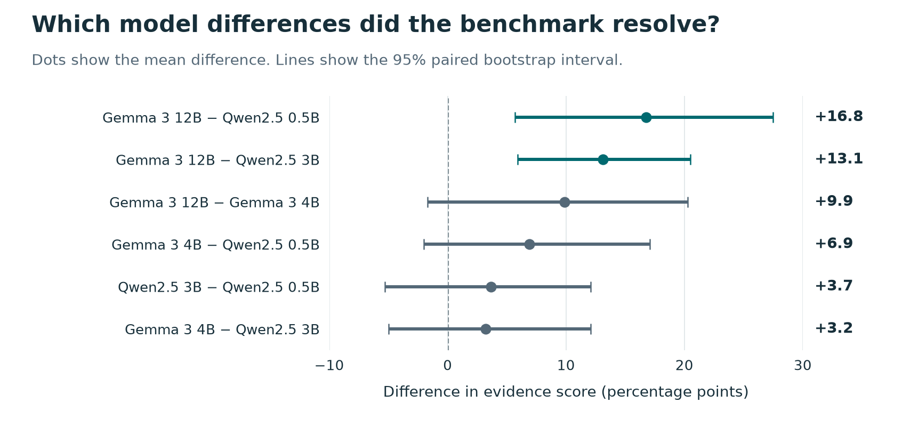

# ClaimTrace

ClaimTrace tests whether a language model can trace a conclusion to the records that support it. Each prompt presents a short fictional case, four possible interpretations, and numbered records. The model chooses one interpretation and cites the smallest set of records that establishes it.

**30 matched pairs · 60 prompts · 6 evidence skills.** One record changes within each pair. In 21 pairs the change warrants a different conclusion. In nine the same conclusion still holds. Each variant goes into a fresh conversation.

## Reproduce a comparison

From the repository root, run the command below with Python 3.9 or newer. It scores the four saved model runs for the default ordering using only the Python standard library. Model weights and API credentials are unnecessary for this step.

~~~sh
python3 claimtrace.py compare --table results/local-pilot/*.jsonl
~~~

To reproduce the full calibration across **both** orderings, including per-skill scores and paired comparisons, run the report generator.

~~~sh
python3 results/report.py
~~~

## What changes in a matched pair?

A clinic reports that its mean wait fell from 50 to 35 minutes, a 30% decrease. Both versions ask which steps a reporter checked and who collected the underlying measurements. Only the fourth record changes.

~~~mermaid
flowchart TD
    accTitle: Two ways to verify a reported decline in clinic waiting time
    accDescr: Both variants start with staff timings. In A the reporter uses published means. In B the reporter uses individual visit records.
    S["Clinic staff time each visit"] --> M["Clinic publishes monthly means"]
    S --> R["Clinic keeps individual visit records"]
    M --> A["Variant A · Reporter checks the 30% calculation"]
    R --> B["Variant B · Reporter recomputes both means and the 30% decrease"]
~~~

In both versions, record 1 identifies the staff as the observers. Record 4 identifies what the reporter calculated. The correct interpretation changes even though the required citations stay the same. [Inspect case m01](cases/measurement.json)

| Skill | Example judgment |
| --- | --- |
| Source lineage | Do two archive files trace back to the same count? |
| Scope of verification | Does witnessing a desk opening corroborate shorter waits? |
| Measurement independence | Could two separately operated gauges share a calibration error? |
| Denominators and coverage | What can be inferred about passengers counted on overlapping routes? |
| Causal attribution | What effect does a lottery estimate when some recipients decline the offer? |
| Conflicting records | Which figure remains in force after a partial correction? |

## What the calibration showed

Four quantized models answered every prompt under two orderings, producing **480 responses across 30 scenarios**. Gemma 3 12B scored 16.8 percentage points above Qwen2.5 0.5B on the evidence score. Its 95% paired bootstrap interval ran from +5.7 to +27.5 points. The 3.2-point gap between Gemma 3 4B and Qwen2.5 3B had an interval spanning zero.

Under strict pair scoring, every model failed the same 28 of 30 pairs in both orderings. The evidence score credits partial citation overlap when the conclusion is correct. These development results describe the four tested configurations. Each skill has five pairs, and performance on frontier models remains unmeasured. [Read the calibration report and numerical intervals](results/README.md)

## How scoring works

| Measure | Rule |
| --- | --- |
| **Evidence score** | A wrong verdict or invalid citation list earns zero. With the right verdict, credit equals the best F1 overlap with an accepted citation set. Average over all prompts. |
| **Verdict accuracy** | Count correct choices, including a recognizable choice in a JSON object with invalid citations. |
| **Exact grounding** | Require both the correct choice and an exact accepted set of record numbers. |
| **Strict pair pass** | Require exact grounding on both variants. The matched-verdict measure checks only the two choices. |

For a correct verdict requiring records 1, 3, and 4, citing only 1 and 3 earns **0.80**. The overlap is twice the two shared records divided by the five total entries across the two sets. An extra citation increases the denominator.

## Evaluate another model

The built-in macOS and Linux runner uses a Chat Completions endpoint. Replace the model ID and API root with those of your deployment. The example requests JSON Schema output and temperature zero to match the local calibration condition.

~~~sh
mkdir -p runs
python3 claimtrace.py run --base-url http://localhost:11434/v1 \
  --model YOUR_MODEL --structured --temperature 0 --output runs/model-a.jsonl
python3 claimtrace.py score --details runs/model-a.jsonl > runs/model-a-score.json
python3 claimtrace.py compare --table results/local-pilot/qwen-3B.jsonl runs/model-a.jsonl
~~~

Each request contains one prompt. Every saved row includes the response, model identity, settings, and benchmark fingerprint. Rerun the same command to resume. Use a separate file per model and seed. For an authenticated endpoint, pass the environment variable name with `--key-env`. An endpoint that supports only plain text can run with `--structured` omitted. Record that decoding difference when reporting scores.

**Using another adapter.** Export one JSON object per line. Send the `prompt` field to the model and retain its opaque `id` locally.

~~~sh
mkdir -p runs
python3 claimtrace.py --seed 107 export > runs/prompts-107.jsonl
~~~

Write each returned answer as a line containing the exported `id` and a `response` field. The response can be raw model text or a JSON object such as `{"choice":"B","evidence":[2,4]}`. Include every ID exactly once. Use the export seed when scoring and comparing.

## Data and reproducibility

- The versioned bank contains both variants, answer keys, accepted citation sets, and explanations. In source JSON, `answer` indexes the options starting at one. Export shuffles the options and withholds the keys and pair labels. The difficulty tiers are author estimates. [Case bank](cases/)
- The qualitative clinic exercise accepts free-text answers and includes a worked scorecard. [Prompts](pilot/prompts.md) · [Grading key](pilot/keys.md)
- Validate the bank with `python3 claimtrace.py validate` and run the tests with `python3 -m unittest discover -s tests -v`. The repository uses the [MIT license](LICENSE).
