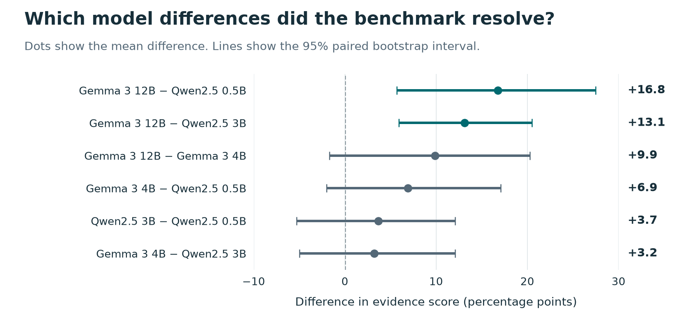

# Calibration results

Four local instruction models answered 60 prompts under two orderings. Those **480 responses cover 30 distinct scenarios**. The headline measure is the mean evidence score, which gives citation credit only for a correct conclusion. [Benchmark and scoring rules](../README.md#how-scoring-works)

Gemma 3 12B scored **37.6%**, compared with **20.8%** for Qwen2.5 0.5B. Two of the six paired comparisons had 95% bootstrap intervals entirely above zero. The other four intervals included zero. The largest source of the observed differences was the choice of conclusion. Holding each model's verdicts fixed, its citations improved its score by only 0.3 to 2.8 percentage points over citing every record.

## Reading the comparisons

Each dot is the first named model's score minus the second's. For each scenario, we averaged the two variants and both orderings before taking the difference. The intervals resample the 30 scenarios with replacement 2,000 times. They describe variation across the authored scenarios and use no adjustment for the six comparisons. The [matched comparisons table](#matched-comparisons) gives the exact values.

## Detailed results

### Model scores

| Model (Q4_K_M) | Mean evidence score | Correct verdicts | Strict pair passes |
| --- | --- | --- | --- |
| Qwen2.5 0.5B | 20.8% | 34/120 | 1/60 |
| Qwen2.5 3B | 24.5% | 40/120 | 0/60 |
| Gemma 3 4B | 27.7% | 45/120 | 2/60 |
| Gemma 3 12B | 37.6% | 59/120 | 0/60 |

Each model answered 60 prompts twice. The strict rule requires a correct verdict and exact citations on both variants in the same ordering.

### Answer order and citation selection

| Model | Evidence, seed 41 | Evidence, seed 107 | Choice retained | Same verdicts, cite all | Invalid |
| --- | --- | --- | --- | --- | --- |
| Qwen2.5 0.5B | 21.1% | 20.6% | 28/55 | 19.7% | 0 |
| Qwen2.5 3B | 26.0% | 23.0% | 28/55 | 23.6% | 0 |
| Gemma 3 4B | 27.0% | 28.5% | 36/55 | 27.4% | 0 |
| Gemma 3 12B | 38.5% | 36.7% | 34/55 | 34.8% | 0 |

Choice retention counts the 55 packets whose options changed order. The cite-all column preserves each model's verdict and replaces its citations with every record.

### Does the model follow a change in the evidence?

Both verdicts must be correct within a pair and ordering. A fixed semantic answer cannot pass a pair whose supported conclusion changes. Invariant pairs test whether a model keeps the conclusion when the edit leaves its support intact.

| Model | Changed conclusion, both correct | Invariant conclusion, both correct |
| --- | --- | --- |
| Qwen2.5 0.5B | 2/42 | 2/18 |
| Qwen2.5 3B | 2/42 | 3/18 |
| Gemma 3 4B | 4/42 | 4/18 |
| Gemma 3 12B | 4/42 | 10/18 |

### Skill profile

| Evidence skill | Qwen2.5 0.5B | Qwen2.5 3B | Gemma 3 4B | Gemma 3 12B |
| --- | --- | --- | --- | --- |
| causal attribution | 10.0% | 23.1% | 13.6% | 47.3% |
| conflicting records | 41.0% | 40.7% | 48.6% | 52.1% |
| denominators and coverage | 13.3% | 7.8% | 36.8% | 27.0% |
| measurement independence | 15.2% | 24.4% | 15.8% | 33.6% |
| scope of verification | 29.0% | 15.5% | 22.6% | 32.4% |
| source lineage | 16.4% | 35.5% | 29.0% | 33.1% |

### Intended difficulty and measured scores

| Intended tier | Qwen2.5 0.5B | Qwen2.5 3B | Gemma 3 4B | Gemma 3 12B |
| --- | --- | --- | --- | --- |
| anchor | 17.2% | 28.3% | 33.4% | 50.4% |
| intermediate | 23.0% | 30.1% | 33.2% | 34.7% |
| stretch | 21.5% | 17.3% | 19.4% | 31.5% |

### Matched comparisons

| Models | Mean difference (percentage points) | 95% paired bootstrap interval |
| --- | --- | --- |
| Qwen2.5 3B minus Qwen2.5 0.5B | +3.7 | [-5.3, +12.1] |
| Gemma 3 4B minus Qwen2.5 0.5B | +6.9 | [-2.0, +17.1] |
| Gemma 3 12B minus Qwen2.5 0.5B | +16.8 | [+5.7, +27.5] |
| Gemma 3 4B minus Qwen2.5 3B | +3.2 | [-5.0, +12.1] |
| Gemma 3 12B minus Qwen2.5 3B | +13.1 | [+5.9, +20.5] |
| Gemma 3 12B minus Gemma 3 4B | +9.9 | [-1.7, +20.3] |

### Where the benchmark separates these runs

After averaging the two orderings within each model, 1 of 30 pairs fall near the evidence-score floor, 0 are near the ceiling, and 29 fall between those thresholds. Under the strict rule, 28 pairs failed in every run, 0 passed in every run, and 2 had mixed outcomes.

On 18 pairs the highest and lowest model scores differed by at least 25 percentage points. The following three had the widest observed spread. These examples were selected after scoring.

| Example pair | Skill | Qwen2.5 0.5B | Qwen2.5 3B | Gemma 3 4B | Gemma 3 12B |
| --- | --- | --- | --- | --- | --- |
| m10 | denominators and coverage | 0.0% | 0.0% | 100.0% | 0.0% |
| m08 | denominators and coverage | 0.0% | 18.8% | 18.8% | 75.0% |
| p05 | source lineage | 0.0% | 70.0% | 56.7% | 44.9% |

Citing every record yields 73.2% mean citation F1. Coupled with a uniformly random choice, that strategy earns an expected 18.3% evidence score. The expected verdict accuracy for random choice is 25%.

## Scope and limitations

- A pair falls near the floor when every model averages at most 10% on its two variants across both orders. A pair falls near the ceiling when every model averages at least 90%. An interior pair can still give similar scores to all four models.
- The six skill profiles each cover five pairs. The authored difficulty bands contain eight anchor, ten intermediate, and twelve stretch pairs. Their measured ordering varies by model.
- This is a development calibration on four quantized configurations. We adopted partial-credit scoring after early runs exposed a floor in strict pair passing. We also clarified a matching claim, added plausible background records, and removed a sample answer from the prompt. The published responses use the revised packets. Evaluation on unseen cases and frontier models remains open.

## Reproduce the report

From the repository root, regenerate the tables with the Python standard library. The script checks model identity, prompt seed, decoding settings, and the benchmark fingerprint before calculating scores.

~~~sh
python3 results/report.py
~~~

To regenerate the figure in an environment with Matplotlib installed, run `python3 results/plot_comparisons.py`. The benchmark CLI and table generator use only the standard library.

| Local run setting | Value |
| --- | --- |
| Inference runtime | llama.cpp b12556, one slot |
| Weights | Q4_K_M instruction models |
| Context and generation limits | 2,048 tokens of context, 110 generated tokens |
| Decoding | Temperature 0, JSON Schema constrained, server seed 41 |
| Administration | One prompt per fresh message list, benchmark seeds 41 and 107 |

The schema specified an answer letter and an array of integers. The raw assistant text, served model identity, and finish reason are retained for each response. [Seed 41 responses](local-pilot/) · [Seed 107 responses](order-check/)

The tested weight revisions are [Qwen2.5 0.5B](https://huggingface.co/Qwen/Qwen2.5-0.5B-Instruct-GGUF/tree/9217f5db79a29953eb74d5343926648285ec7e67), [Qwen2.5 3B](https://huggingface.co/Qwen/Qwen2.5-3B-Instruct-GGUF/tree/7dabda4d13d513e3e842b20f0d435c732f172cbe), [Gemma 3 4B](https://huggingface.co/ggml-org/gemma-3-4b-it-GGUF/tree/d0976223747697cb51e056d85c532013931fe52e), and [Gemma 3 12B](https://huggingface.co/ggml-org/gemma-3-12b-it-GGUF/tree/ec0cbabd8dbff316f659876a50202295c3c4a314). The runtime is available from the [llama.cpp release](https://github.com/ggml-org/llama.cpp/releases/tag/b12556).
